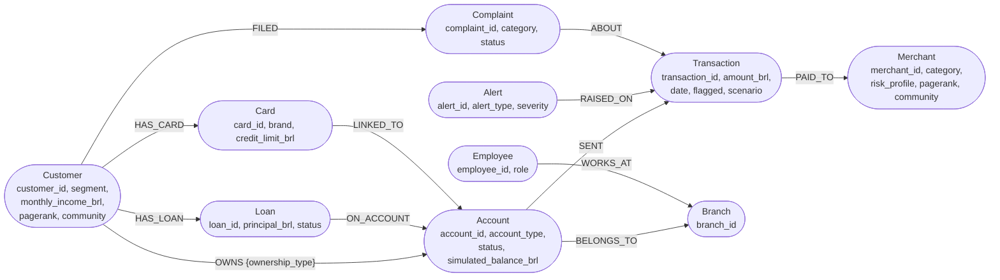
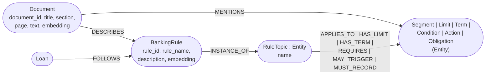

# Modelo do grafo (LPG no Neo4j)

O diagrama abaixo é renderizado automaticamente pelo GitHub (Mermaid). Para o artigo, abra este arquivo no GitHub e capture a imagem, ou cole o bloco em <https://mermaid.live> e exporte como PNG/SVG.

## Dados estruturados (Etapas 2 e 3)

## Conhecimento (Etapa 4, Text-to-Graph, e KAG)

## Decisões de modelagem

| Decisão | Motivo |
|---|---|
| Transação é **nó**, não aresta | Permite ligar alerta, reclamação e estabelecimento à transação, filtrar por data e rastrear a origem (multi-hop). |
| Só existe `SENT` (conta → transação) | As transações do dataset não têm conta de destino, só estabelecimento (`PAID_TO`). |
| Titularidade na aresta `OWNS {ownership_type}` | Conta conjunta = mais de um `OWNS` para a mesma conta; é o caminho da "relação indireta" entre clientes. |
| `Loan -[:FOLLOWS]-> BankingRule` por heurística | Todo empréstimo segue as regras ativas "Empréstimo Pessoal" (o dataset não traz esse vínculo). |
| 30 regras → 10 temas (`INSTANCE_OF`) | Os 30 documentos são 10 textos em 3 versões; o tema canônico evita duplicar conhecimento (resolução de entidades). |
| `pagerank` e `community` como propriedades | Resultado dos algoritmos de grafo (`graph_algorithms.py`), consultável por Cypher e pelo LLM. |

## Índices e restrições

| Tipo | Onde | Criado por |
|---|---|---|
| Unicidade (constraint) | IDs de todos os 12 labels de negócio | `schema.cypher` |
| Unicidade (constraint) | `Entity.key` | `extract_entities.py` |
| B-tree | `Transaction.timestamp`, `Transaction.flagged`, `Loan.status`, `Alert.alert_date` | `schema.cypher` |
| B-tree | `Customer.community`, `Merchant.community` | `graph_algorithms.py` |
| Full-text | `Merchant(merchant_name, category)`, `BankingRule(rule_name, description)`, `Document(title, text)` | `schema.cypher` |
| Vetorial (384 dim, cosseno) | `Document.embedding`, `BankingRule.embedding` | `schema.cypher` |

## Volumes

500 clientes, 823 contas, 868 titularidades (45 conjuntas), 9.749 transações (100 sinalizadas), 100 alertas, 200 empréstimos, 500 cartões, 150 estabelecimentos, 20 agências, 60 funcionários, 150 reclamações, 30 documentos, 30 regras, 34 entidades extraídas e 23 relações extraídas.
